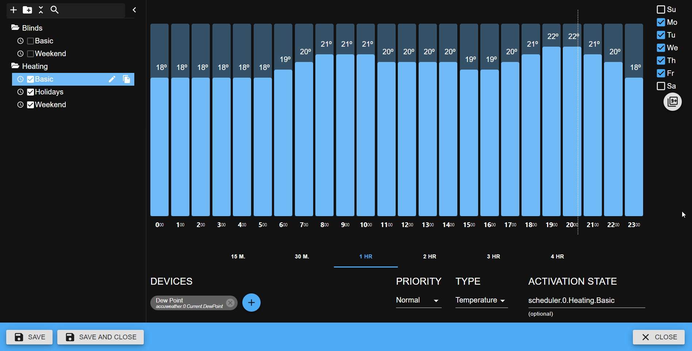
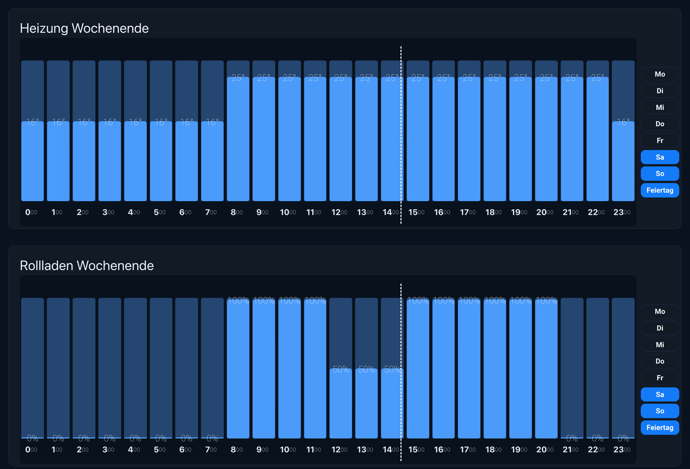

# ioBroker Scheduler Adapter

  

This adapter is designed to control devices on a schedule. For example, heating or watering control.

You can create the profiles with different priority: normal (e.g., workdays), high (e.g., weekends) and highest (e.g., for holidays).
The profile with higher priority overloads other profiles.

For every profile, the active variable will be created.
But the user can select their own activation variable, e.g., to control holidays. 

The user should add devices to profile, and all devices in profile will be set to the same value.

This adapter has vis2 widget.

Two widgets in a dark vis-2 view: the setpoint of the heating and the position of the shutters on weekends.
Every bar is one hour and is set by dragging it. On the right the weekdays and holidays of the profile are selected.

## Profile types and data points
The type of the profile decides which data points can be added to it and which value is written into them.

| Type        | Required data point                                        | Written value                                                                               |
|-------------|------------------------------------------------------------|---------------------------------------------------------------------------------------------|
| Percent     | `number` with `min` and `max`                              | The value is scaled linearly between `min` and `max`: `min + round((max - min) * value / 100)` |
| Percent     | unit `%`                                                   | The value 0-100 unchanged                                                                   |
| Temperature | `number`                                                   | The value unchanged                                                                         |
| On/Off      | `boolean`                                                  | `true` or `false`                                                                           |
| Custom      | `number`                                                   | The value unchanged                                                                         |

Data points with `common.type` `mixed` are accepted for all types.
The dialog to select the data points offers only the data points that match the type of the profile.
Do not set `common.type` of a data point to `custom`: this is not a valid type of ioBroker, use `number`.

## Web components
The adapter brings the profile view as a web component too (`common.webComponents`, `@iobroker/web-components`), so
that Aura, ioBroker.devices, admin and every other host can show it. vis-2 keeps showing its own widget.

| Tag                     | Shows                                                                                  |
|-------------------------|----------------------------------------------------------------------------------------|
| `iob-scheduler-profile` | One profile: a bar per interval of the day, the days of the week and the holiday flag |

Settings:
- **Profile** - a state of the profile, e.g. `scheduler.0.Heating.Living room_active`; the instance is taken from the ID
- **Title** - shown above the profile, nothing if empty
- **Read only**
- **Hide days of week**

Drag a bar up or down to set its value, or across several bars to set them all. Tap the time below a bar to select it:
a change then applies to all selected intervals. On/off intervals switch with a tap.

A web component may not write objects, so it sends its changes to the instance with the message `setProfile`
(`{ id, intervals?, dow?, holiday? }`), which writes them into the instance object on behalf of the user of the
connection. The instance must run for that, and it restarts after every change, like after saving the settings in admin.

<!--
	Placeholder for the next version (at the beginning of the line):
	### **WORK IN PROGRESS**
-->

## Changelog
### **WORK IN PROGRESS**
* (@GermanBluefox) The adapter declares the versions it needs: js-controller 6.0.11 and admin 7.6.20 or newer. It cannot be installed from GitHub, because the build is not part of the repository
* (@GermanBluefox) Fixed profiles of type Custom: the adapter rejected the data points accepted by admin and did not write the value. Documented which data points every profile type needs (#448)

### 2.1.1 (2026-11-09)
* (@GermanBluefox) Web component: the holiday button shows its whole name, and decimal values follow the number format of the system

### 2.1.0 (2026-11-08)
* (@GermanBluefox) Added the web component `iob-scheduler-profile` for Aura and other hosts (`common.webComponents`); it saves its changes through the new message `setProfile`

### 2.0.3 (2026-11-02)
* (@GermanBluefox) Corrected the widget: changes in one widget were overwritten by other widgets of the same instance

### 2.0.2 (2026-10-18)
* (@GermanBluefox) Fixed: profiles could not be selected if the first element in the list was a folder (e.g. after deleting profiles)

### 2.0.1 (2026-10-17)
* (@GermanBluefox) Packages were updated

[Older changelogs can be found there](CHANGELOG_OLD.md)

## License
The MIT License (MIT)

Copyright (c) 2021-2026 bluefox <dogafox@gmail.com>

Permission is hereby granted, free of charge, to any person obtaining a copy
of this software and associated documentation files (the "Software"), to deal
in the Software without restriction, including without limitation the rights
to use, copy, modify, merge, publish, distribute, sublicense, and/or sell
copies of the Software, and to permit persons to whom the Software is
furnished to do so, subject to the following conditions:

The above copyright notice and this permission notice shall be included in all
copies or substantial portions of the Software.

THE SOFTWARE IS PROVIDED "AS IS", WITHOUT WARRANTY OF ANY KIND, EXPRESS OR
IMPLIED, INCLUDING BUT NOT LIMITED TO THE WARRANTIES OF MERCHANTABILITY,
FITNESS FOR A PARTICULAR PURPOSE AND NONINFRINGEMENT. IN NO EVENT SHALL THE
AUTHORS OR COPYRIGHT HOLDERS BE LIABLE FOR ANY CLAIM, DAMAGES OR OTHER
LIABILITY, WHETHER IN AN ACTION OF CONTRACT, TORT OR OTHERWISE, ARISING FROM,
OUT OF OR IN CONNECTION WITH THE SOFTWARE OR THE USE OR OTHER DEALINGS IN THE
SOFTWARE.
